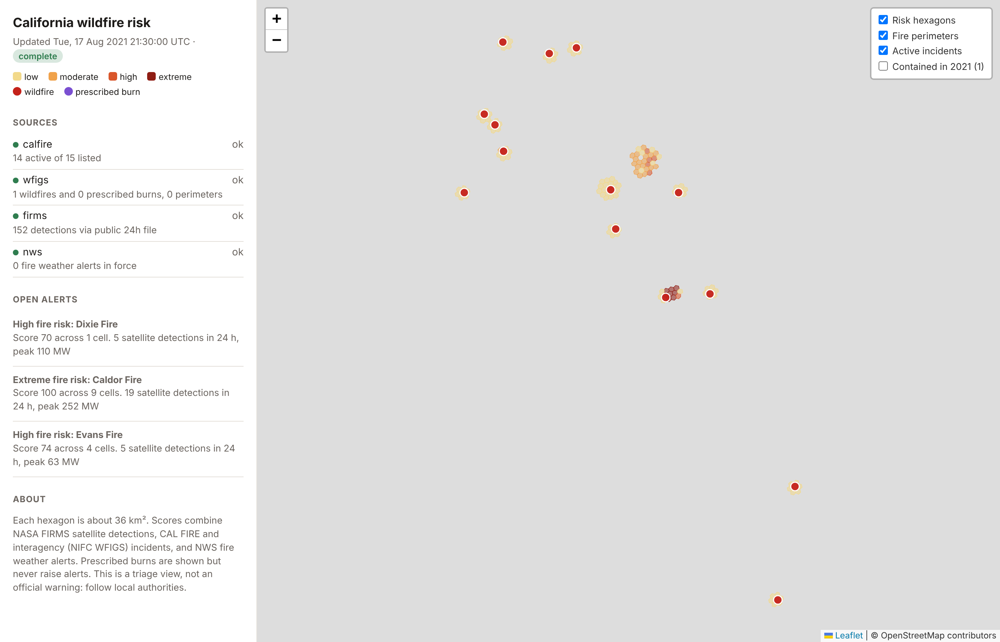

# wildfire-risk-feed

[](https://github.com/AaronJAdler/wildfire-risk-feed/actions/workflows/ci.yml)
[](https://github.com/AaronJAdler/wildfire-risk-feed/actions/workflows/live.yml)

A near-real-time California wildfire risk feed. Every 3 hours it combines **CAL FIRE** and **NIFC WFIGS** (interagency)
incidents and perimeters, **NASA FIRMS** satellite detections and **NWS** fire weather alerts into a scored H3 hexagon map,
flags satellite heat that no reported incident explains, and sends deduplicated alerts.

**[Live map](https://aaronjadler.github.io/wildfire-risk-feed/)** · [GeoJSON feed](https://aaronjadler.github.io/wildfire-risk-feed/feed.geojson) · [status](https://aaronjadler.github.io/wildfire-risk-feed/status.json)

**ArcGIS Online:** [Instant App](https://www.arcgis.com/apps/instant/basic/index.html?appid=0cfa3cabe6704c51976fff69a9414747) · [web map](https://www.arcgis.com/home/item.html?id=c21761c263b9432998b850b1ca266bb6). The live feed's GeoJSON layers over CAL FIRE's Fire Hazard Severity Zones and Fire Responsibility Areas. ArcGIS reads the feed's public files directly, so it updates with every run.



*The recorded scenario at its last tick. The live site shows an OpenStreetMap basemap; it was blocked where this screenshot was taken.*

## What it demonstrates

- **Integrating unreliable public APIs**: retries with backoff and jitter, `Retry-After`,
  ETag / 304 caching, a circuit breaker, error pages served with status 200 treated as failures,
  NWS pagination, superseding updates and cancellations, and API keys masked in every log.
- **Data contracts at the edge**: every record is validated; bad ones are quarantined with a
  reason, including the real CAL FIRE record whose longitude was published as -11846461.
- **Degraded operation**: each source is `ok`, `stale` or `down`; the feed always publishes, says
  when it is partial, and never lets missing data clear an alert.
- **Spatial processing without a GIS stack**: H3 cells, size-aware matching of satellite heat to
  fires, and a 72-hour footprint that keeps a spreading fire's heat attributed to it.
- **Reliable notifications**: one alert per fire, hysteresis and cooldown, and a transactional
  outbox with stable ids sent as `Idempotency-Key`.
- **Zero-cost operation**: a GitHub Actions schedule, state in the Actions cache, a static site
  on GitHub Pages.

## The scenario: satellites saw Caldor first

`uv run riskfeed replay fixtures/caldor-2021` replays four moments in August 2021 using CAL FIRE's
real published feed for those days (detections and weather alerts are generated; see
[fixtures/README.md](fixtures/README.md)):

```
== 1-satellites-first at 2021-08-15 09:30 UTC: complete
   raised     Possible new fire              <- heat at Caldor, not yet listed
   raised     Extreme fire risk: Dixie Fire
   ...
== 2-calfire-lists-caldor at 2021-08-15 21:30 UTC: complete
   confirmed  Confirmed: Caldor Fire         <- 12 h after the satellites
   expired    Possible new fire: no further heat   <- a field burn
== 3-firms-outage at 2021-08-16 21:30 UTC: partial (firms down)
   (no transitions: scores fell, but nothing clears on missing data)
== 4-recovery at 2021-08-17 21:30 UTC: complete
   cleared    Fire risk eased: Monument Fire
```

The 12-hour lead is the gap between the recorded ticks; at the live 3-hour cadence it is
measured to within 3 hours.

## Run it

Needs Python 3.12 and [uv](https://docs.astral.sh/uv/). Works on Windows, macOS and Linux.

```bash
uv sync
uv run pytest                                   # 43 tests, about 20 seconds
uv run riskfeed replay fixtures/caldor-2021     # writes .replay/public/
uv run riskfeed tick                            # one live run, writes public/
```

Open `public/index.html` through a local server (`python -m http.server -d public`) to see the map.

Optional settings, as environment variables (or repository secrets for the live workflow):

| Variable | Effect |
|---|---|
| `FIRMS_MAP_KEY` | Use the FIRMS area API for three VIIRS satellites. Without it, NASA's public 24-hour file is used. Free key: firms.modaps.eosdis.nasa.gov/api |
| `RISKFEED_WEBHOOK_URL` | Also POST alerts to this URL (Slack-compatible `text` plus the full alert). |

## How it was verified

| Check | Where |
|---|---|
| Lint (ruff), strict types (mypy), 43 tests: HTTP resilience, each source's parsing and failure modes, score properties, attribution, alert lifecycle, circuit breaker, webhook retries, idempotent reruns, the full scenario | Locally and in CI |
| Scenario replay | CI, printed to the run summary |
| Live CAL FIRE, FIRMS and NWS | The scheduled `Live feed` workflow only. The APIs were not reachable from where this was built, so the first live runs are the first contact; check the workflow's run summaries. |

## Design

- [Architecture](docs/architecture.md): diagrams of a run, attribution and the alert lifecycle.
- [ADR 0001](docs/adr/0001-missing-data-never-clears-an-alert.md): degrade per source; missing data never clears an alert
- [ADR 0002](docs/adr/0002-h3-cells-and-a-transparent-score.md): H3 cells and a transparent score
- [ADR 0003](docs/adr/0003-attributing-heat-to-fires.md): attributing heat to fires
- [ADR 0004](docs/adr/0004-transactional-outbox.md): transactional outbox, at-least-once delivery
- [ADR 0005](docs/adr/0005-static-site-on-github-actions.md): GitHub Actions schedule and Pages
- [ADR 0006](docs/adr/0006-recorded-scenario-from-real-data.md): a recorded scenario from real CAL FIRE data
- [ADR 0007](docs/adr/0007-interagency-incidents-and-perimeters.md): interagency incidents, perimeters and prescribed burns

## Limits

- The score is a triage heuristic, not a fire-behaviour model: no fuels, terrain or wind speed.
- Fires without a WFIGS perimeter are matched by origin point; where such fires sit close
  together, heat can go to the wrong one.
- Freshness is bounded by the 3-hour schedule, and GitHub may delay scheduled runs.
- Not an official warning service. Follow local authorities.
