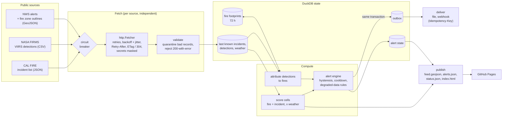
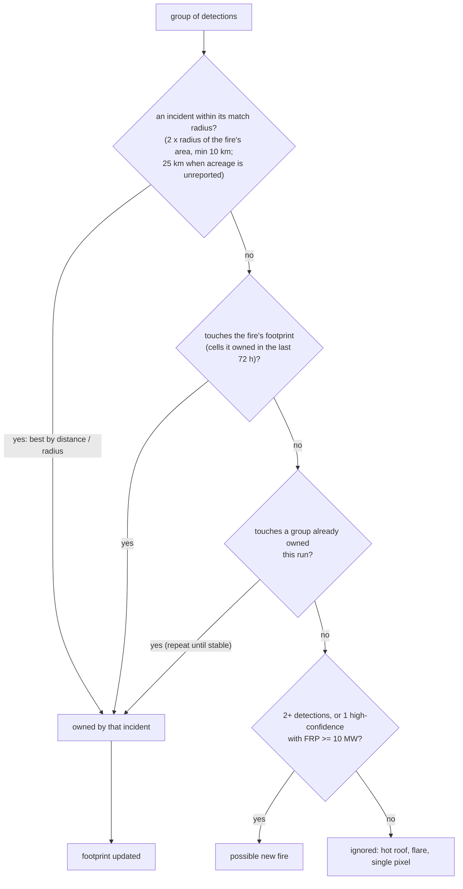
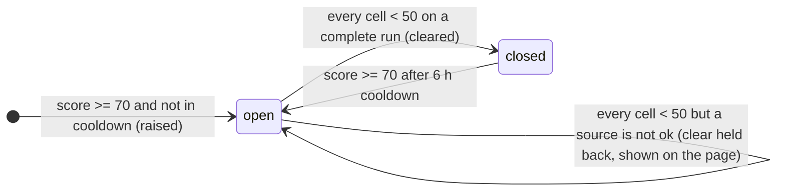

# Architecture

The feed runs every 3 hours. Each run fetches three public sources, scores every H3 cell in
California, updates alerts, sends notifications and publishes a static site. State carries over
between runs in one DuckDB file.

## One run

## Health and what each state allows

Every source ends a run in one of three states. The feed always publishes from the best data it
has, and labels the run `partial` whenever a source is not `ok`. What changes is which alert
transitions are allowed, because a missing source makes scores drop for the wrong reason.

| Health | Meaning | Data used |
|---|---|---|
| ok | fetched and valid this run | fresh |
| stale | failed this run, last success within its limit (CAL FIRE 6 h, FIRMS 12 h, NWS 2 h) | last known |
| down | no success within its limit | last known, decaying |

| Transition | Needs |
|---|---|
| Risk alert raised or escalated | any data (higher scores from partial data are still real heat) |
| Risk alert cleared | every source `ok` |
| Possible new fire raised | CAL FIRE not `down` (otherwise every fire looks new) |
| Possible new fire confirmed | CAL FIRE `ok` |
| Possible new fire expired | FIRMS `ok` |

## Attributing heat to fires

CAL FIRE publishes where a fire started, not where it is now. A large fire's front can be 50 km
from that point. Detections are grouped by touching H3 cells at resolution 7, and each group is
assigned an owner:

The replay showed why each step exists. Without the footprint, Caldor's spread by day 3 produced
four false "possible new fire" alerts. Ranking by plain distance credited the Dixie Fire's front to
the small Evans Fire nearby; ranking by distance relative to each fire's size fixes most of that,
not all (see ADR 0003).

## Alert lifecycle

Possible new fires go `open → confirmed` when CAL FIRE lists a fire there, or
`open → expired` after 12 hours with no further heat.

Every transition increments the alert's version and writes one outbox row with id
`<key>:v<version>` in the same DuckDB transaction as the state change. Delivery is at least once,
and receivers deduplicate on that id, which webhooks also get as an `Idempotency-Key` header.

## The recorded scenario

`fixtures/caldor-2021` replays four moments in August 2021 using CAL FIRE's real feed for those
days (from Project 1's replay data). Detections and weather alerts are generated; see
[fixtures/README.md](../fixtures/README.md).

| Tick (UTC) | What the sources say | What the feed does |
|---|---|---|
| Aug 15 09:30 | Heat at Caldor; CAL FIRE does not list it yet | Possible new fire at Caldor; risk alerts for Dixie, Evans, Monument |
| Aug 15 21:30 | CAL FIRE lists Caldor | Confirmed, 12 h after the satellites (the gap between runs); a field burn expires |
| Aug 16 21:30 | FIRMS answers 503 four times | Feed `partial`; scores drop but nothing clears; the held-back clear is shown |
| Aug 17 21:30 | FIRMS recovers; Monument is quiet | Monument clears; Caldor's spread stays attributed to Caldor |

## Code map

| File | Responsibility |
|---|---|
| `config.py` | every threshold, with its reason |
| `http.py` | resilient GET: retries, Retry-After, conditional requests, secret masking |
| `sources/` | CAL FIRE, FIRMS (keyed API or public file), NWS (alerts, updates, cancels, zones) |
| `store.py` | DuckDB state, HTTP cache, fetch log, quarantine, alerts, outbox |
| `scoring.py` | the 0-100 cell score |
| `fires.py` | clustering and attribution of detections |
| `alerts.py` | alert lifecycles and the degraded-data rules |
| `delivery.py` | file and webhook sinks |
| `publish.py`, `web/index.html` | the public files and the Leaflet map |
| `pipeline.py` | one run, end to end |
| `fixtures.py` | replays recorded responses through the real HTTP client |
